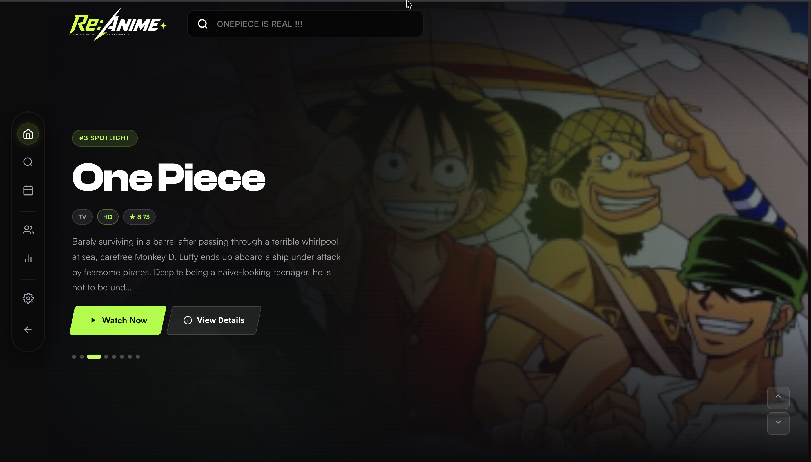

# AnimeXplore



Anime streaming web app with cached search, fast ID resolution, and MegaPlay embeds.

## Features

- **Search** — Jikan API with server + client cache
- **Fast resolve** — MAL ID → Anikoto embed ID or MAL/AniList fallback in one request
- **Browse** — Paginated recent anime from Anikoto
- **Stream** — MegaPlay iframe (`/stream/s-2/{embed_id}/sub` or `/stream/mal/{id}/{ep}/sub`)
- **Design** — PlayUp glassmorphism UI from `Design.json`

## Quick start (local)

```bash
npm install
npm start
```

Open **http://localhost:8765**

> Do not use Live Server (port 5500). The API proxy is required.

## Recommended browser

Use **[Brave Browser](https://brave.com/)** for the best experience — faster page loads, built-in ad/tracker blocking, and reliable handling of streaming embed redirects.

## Deploy to Vercel

### Option A — GitHub (recommended)

1. **Push to GitHub**
   ```bash
   git init
   git add .
   git commit -m "AnimeXplore initial deploy"
   git branch -M main
   git remote add origin https://github.com/rathod-ramraj/animexploree.git
   git push -u origin main
   ```

2. **Import on Vercel**
   - Go to [vercel.com/new](https://vercel.com/new)
   - Click **Import Git Repository** and select your repo
   - Framework Preset: **Other** (no build command needed)
   - Root Directory: `.` (project root)
   - Build Command: leave empty (or `npm run vercel-build`)
   - Output Directory: leave empty
   - Click **Deploy**

3. **Done** — Vercel reads `vercel.json` automatically:
   - Static files (`index.html`, `css/`, `js/`, `Design.json`) are served
   - `/api/*` and `/proxy/*` routes go to the Express serverless function in `api/index.js`

4. **Open your live URL** — e.g. `https://animexplore.vercel.app`

### Option B — Vercel CLI (no GitHub)

```bash
npm i -g vercel
cd AniWorld
vercel login
vercel          # first deploy (preview)
vercel --prod   # production deploy
```

### After deploy

- Search and streaming work on the Vercel URL — no `npm start` needed
- The yellow proxy banner should **not** appear (API runs on same domain)
- Redeploy automatically on every `git push` if GitHub is connected

### Troubleshooting

| Issue | Fix |
|-------|-----|
| API 404 | Ensure `vercel.json` is at project root and `api/index.js` exists |
| Static files 404 | Check routes in `vercel.json` include `css/**` and `js/**` |
| Cold start slow | First request after idle may take 1–3s — normal for serverless |
| Node version | Vercel uses Node 18+ by default (`engines` in `package.json`) |

### Vercel structure

| Path | Handler |
|------|---------|
| `/api/search` | Cached Jikan search |
| `/api/resolve/mal/:id` | Fast ID + episode resolve |
| `/api/resolve/series/:id` | Anikoto series resolve |
| `/api/recent` | Recent anime list |
| Static files | `index.html`, `css/`, `js/`, `Design.json` |

## API flow

```
Search → /api/search?q=naruto
       → /api/resolve/mal/20
       → episodes + streamMethod (embed | mal | ani)
       → iframe: megaplay.buzz/stream/...
```

### Two ID types

| ID | Source | Used for |
|----|--------|----------|
| Series ID | Anikoto `/recent-anime` | `/api/resolve/series/{id}` |
| Embed ID | Anikoto `/series/{id}` episodes | `megaplay.buzz/stream/s-2/{embed_id}/sub` |

### Fallback streams

- MAL: `megaplay.buzz/stream/mal/{mal_id}/{ep}/sub`
- AniList: `megaplay.buzz/stream/ani/{ani_id}/{ep}/sub`

## Caching

- **Server** — In-memory cache with TTL (search 30m, resolve 1h)
- **Client** — Memory + `localStorage` for instant repeat loads
- **MAL index** — Built from recent anime pages for fast Anikoto lookup
- **Prefetch** — Top search results prefetched on hover

## Project structure

```
AniWorld/
├── api/index.js       # Vercel serverless entry
├── app.js             # Express app (shared local + Vercel)
├── server.js          # Local dev server
├── server/
│   ├── cache.js       # Server cache + MAL index
│   └── resolve.js     # ID resolution logic
├── js/
│   ├── app.js         # UI logic
│   ├── api.js         # API client
│   ├── cache.js       # Client cache
│   ├── design.js      # Design.json loader
│   └── shape-grid.js  # Background grid
├── css/style.css
├── Design.json        # Design system spec
├── index.html
└── vercel.json
```

## References

- [Anikoto API](https://anikotoapi.site/)
- [MegaPlay](https://megaplay.buzz/)
- [Jikan API](https://jikan.moe/)
